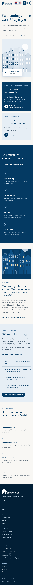
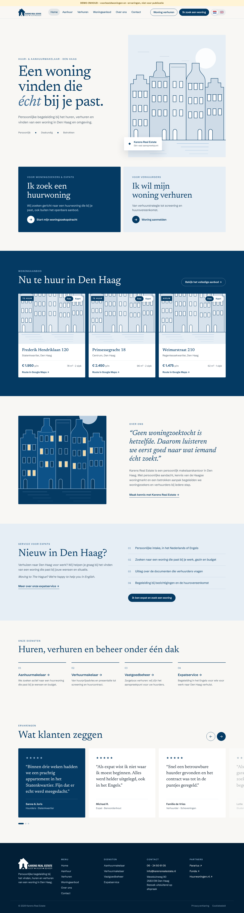

# Karens Real Estate — website

Tweetalige (NL/EN) website voor Karens Real Estate, huur-, aanhuur- en verhuurmakelaar in Den Haag.

- **Techniek:** [Astro 7](https://astro.build) (statisch vooraf gerenderd) met een kleine Node-server voor de formulieren (`@astrojs/node`) en Nodemailer (SMTP).
- **Eisen:** Node.js ≥ 22.12, een SMTP-mailbox en HTTPS via een reverse proxy (bijvoorbeeld Caddy) of een hostingplatform.
- **Documentatie:** [`docs/01-analyse-en-technisch-plan.md`](docs/01-analyse-en-technisch-plan.md) bevat de analyse en de architectuur. [`docs/02-oplevering-en-testrapport.md`](docs/02-oplevering-en-testrapport.md) bevat de testresultaten en de openstaande punten.

## Previews

| Homepage | Aanhuur met stappenformulier | Mobiel |
|---|---|---|
|  |  |  |

Demoversie met voorbeeldwoningen en -ervaringen:

| Homepage (demo) | Woningaanbod (demo) |
|---|---|
|  |  |

Zelf bekijken: `npm install` en dan `npm run demo` → http://localhost:4321. Een conceptpresentatie maken (gelabeld als concept, formulieren versturen niets): `npm run concept` → map `concept-dist/`.

---

## 1. Snel starten (ontwikkeling)

```bash
npm install
npm run dev            # http://localhost:4321 (formulieren werken niet in dev zonder .env, zie hieronder)
```

Formulieren lokaal testen, zonder echte e-mail. De mails komen dan als bestand in `data/dev-mail/`:

```bash
npm run build
MAIL_TRANSPORT=file MAIL_TO=test@example.nl SITE_URL=http://localhost:4321 node server.mjs
```

## 2. Scripts

| Commando | Wat het doet |
|---|---|
| `npm run dev` | Ontwikkelserver met hot reload |
| `npm run build` | Productiebuild naar `dist/`. **Zet eerst `SITE_URL`.** |
| `npm start` | Productieserver (`server.mjs`) |
| `npm run check` | TypeScript- en Astro-typecheck |
| `npm test` | Unit-tests: validatie, tokens, rate limiting, e-mail en outbox |
| `npm run test:e2e` | End-to-end-tests met Playwright tegen de build: alle pagina's, links, SEO, formulieren, beveiliging en mobiel |
| `npm run demo` | Lokale demo met voorbeeldwoningen en -ervaringen; formulieren schrijven naar `data/dev-mail/` |
| `npm run concept` | Conceptpresentatie als statisch pakket in `concept-dist/` |
| `npm run launch-check` | Checklist voor de livegang: wat ontbreekt nog? (exitcode 1 = blokkerend) |
| `node scripts/generate-brand-assets.mjs` | Maakt favicons en de OG-afbeelding opnieuw vanuit het logo |

## 3. Configuratie

Alle instellingen staan in omgevingsvariabelen. Zie **[`.env.example`](.env.example)** voor de volledige lijst met uitleg. In productie start de server **niet** als een verplichte waarde ontbreekt. Zo gaan er geen aanvragen ongemerkt verloren.

| Variabele | Verplicht | Toelichting |
|---|---|---|
| `SITE_URL` | ja (build én runtime) | bijv. `https://www.karensrealestate.nl` |
| `FORM_SECRET` | ja | ≥ 32 tekens, `openssl rand -hex 32` |
| `SMTP_HOST`, `SMTP_PORT`, `SMTP_USER`, `SMTP_PASS`, `SMTP_SECURE` | ja | SMTP-gegevens van de mailprovider |
| `MAIL_FROM` | ja | Afzender. Het domein moet SPF/DKIM hebben voor deze server of dienst. |
| `MAIL_TO` | ja | Ontvanger(s) van de aanvragen |
| `CANONICAL_HOST` | aanbevolen | 301 van andere hostnamen naar de hoofddomeinnaam |
| `TRUST_PROXY_HOPS` | aanbevolen | `1` achter Caddy of nginx, nodig voor correcte rate limiting |
| `FORMS_WEBHOOK_URL`, `FORMS_WEBHOOK_SECRET` | nee | Koppeling met een CRM of Zapier/Make (zie §6) |
| `DATA_DIR` | nee | Map voor de outbox, moet blijvend en schrijfbaar zijn |

Geheimen staan **nooit** in de code of in de frontend.

## 4. Deployment

### Optie A — Docker (aanbevolen)
```bash
cp .env.example .env      # en vul in
docker compose up -d --build
```
De container draait als niet-root-gebruiker, met een healthcheck op `/api/health/` en een volume voor `data/`. Zet er een reverse proxy met HTTPS voor. In [`Caddyfile`](Caddyfile) staat een voorbeeld met automatische certificaten, compressie en een redirect van apex naar www.

### Optie B — Node-host / VPS
```bash
npm ci
SITE_URL=https://www.karensrealestate.nl npm run build
npm ci --omit=dev
NODE_ENV=production node server.mjs     # via systemd/pm2, achter Caddy/nginx
```

### Optie C — Cloudflare Worker
Eén Worker serveert de statische site (`dist/`) en de formulier-API. De code staat in [`worker/`](worker/), de instellingen in [`wrangler.jsonc`](wrangler.jsonc). Er is geen server of Docker nodig, en Cloudflare regelt HTTPS.

Verschillen met de Node-versie:
- **E-mail** gaat via de HTTP-API van [Resend](https://resend.com), omdat Workers geen SMTP kunnen gebruiken. Verifieer het afzenderdomein van `MAIL_FROM` in Resend (SPF/DKIM).
- **Outbox en eenmalige tokens** staan in Workers KV (`KRE_KV`). Een cron-trigger probeert mislukte aanvragen elke 5 minuten opnieuw.
- **Rate limiting** gebeurt per Worker-instantie in het geheugen. Zet voor extra bescherming een WAF-rate-limitregel op `/api/forms/*` in het Cloudflare-dashboard.

```bash
wrangler login
wrangler secret put FORM_SECRET        # openssl rand -hex 32
wrangler secret put RESEND_API_KEY
npm run cf:deploy                      # bouwt met DEPLOY_TARGET=cloudflare en deployt
```
Pas eerst `MAIL_TO`, `MAIL_FROM` en het domein aan in `vars` in `wrangler.jsonc`. Zet het eigen domein aan via `routes`; dat staat als voorbeeld in hetzelfde bestand. Tot dan draait de site op `karensrealestate.<account>.workers.dev`.

Lokaal testen: kopieer `.dev.vars.example` naar `.dev.vars` en voer `npm run cf:dev` uit → http://localhost:8787. De e-mails komen dan in lokale KV (`devmail:…`) in plaats van verstuurd te worden.

### DNS en e-mail
- `A`/`AAAA`-records voor `karensrealestate.nl` en `www` wijzen naar de server.
- Voeg voor de afzender van `MAIL_FROM` een **SPF**- en **DKIM**-record toe. Zonder deze records komen de notificaties mogelijk in de spam.
- HTTPS en HSTS zijn verplicht. HSTS wordt door `server.mjs` gezet zodra `NODE_ENV=production`.

### Na livegang
1. Voeg het domein toe aan **Google Search Console** en dien `https://www.karensrealestate.nl/sitemap.xml` in.
2. Koppel het **Google Business Profile** (zelfde naam, adres en telefoon als op de site) en zet de profiel-URL in `site.sameAs`.
3. Stuur via elk formulier één testaanvraag en controleer of de mail binnenkomt.
4. Monitoring: `GET /api/health/` geeft `{"ok":true,"outbox":0}` terug. Een `outbox` groter dan 0 betekent dat e-mail tijdelijk niet werkt. De server probeert het elke 5 minuten opnieuw.

### Back-ups
De website zelf bevat geen database. De bron is deze Git-repository. Alleen `DATA_DIR/outbox` bevat tijdelijk aanvragen die nog niet verzonden zijn. Die worden automatisch verwijderd na verzending of na 14 dagen, en hoeven niet in een back-up.

## 5. Inhoud beheren

| Wat | Waar |
|---|---|
| Bedrijfsgegevens (telefoon, adres, KvK, profielen) | `src/content/site.ts`. Wordt overal gebruikt: footer, contact, structured data en e-mail. |
| Alle teksten NL / EN | `src/i18n/nl.ts` en `src/i18n/en.ts`. Dezelfde sleutels; de typecheck bewaakt dat. |
| URL's per taal | `src/i18n/routes.ts` |
| Foto's | Zet `hero.jpg`, `over-ons.jpg` en `verhuren.jpg` in `src/assets/photos/`. Ze worden automatisch omgezet naar AVIF/WebP in meerdere formaten. Zonder foto toont de site een illustratie in huisstijl. |
| Woningaanbod | `src/content/listings.ts` (zie §6). Adres en plaats zijn genoeg: postcode en coördinaten voor de kaart met pin worden bij de build opgezocht via PDOK (de gratis adresdienst van de overheid) en bewaard in `src/content/geocode-cache.json`. |
| Klantervaringen | `src/content/reviews.ts`. De sectie verschijnt automatisch zodra er echte reviews in staan. |
| Juridische teksten | `src/views/Privacy.astro` en `src/views/Cookies.astro` |

Na elke wijziging opnieuw bouwen en deployen.

**Demo-modus:** `KRE_DEMO_CONTENT=1 npm run build` toont de voorbeeldwoningen en -reviews uit het ontwerp. Zo'n build is gemarkeerd als demo en staat op `noindex`, en `launch-check` blokkeert hem.

## 6. Koppelingen

**Woningaanbod / Pararius Office.** De koppeling is voorbereid. Hij staat uit tot er een token is; tot dan verwijst de pagina *Woningaanbod* naar het kantoorprofiel op Pararius.

Hoe het werkt:
- Tijdens de build haalt [`src/content/sources/pararius-office.ts`](src/content/sources/pararius-office.ts) het aanbod op. De token komt dus nooit in de browser.
- JSON en XML worden allebei begrepen, en de lijst met woningen wordt automatisch gevonden. Pagina's volgen (paginering) gaat ook vanzelf.
- Verhuurde en ingetrokken woningen worden weggelaten. De labels *Nieuw* en *Onder optie* worden automatisch gezet.
- Postcode, wijk en kaartpin komen uit het adres (PDOK). Foto's worden bij de build gedownload en omgezet naar AVIF/WebP.
- Is de feed onbereikbaar, dan **stopt de build**. De live site houdt dan het laatste goede aanbod in plaats van leeg te raken. Met `PARARIUS_OFFICE_OPTIONAL=1` bouwt hij toch, met de handmatige lijst.
- De GitHub Action [`woningaanbod.yml`](.github/workflows/woningaanbod.yml) controleert elke 30 minuten of het aanbod is veranderd. Alleen dan bouwt en deployt hij opnieuw; hij vergelijkt daarvoor met `/aanbod-versie.txt` op de live site.

**Stappenplan zodra de token er is:**
1. Vraag bij Pararius Office de technische documentatie van de "koppeling eigen website" op: het endpoint en hoe de token meegestuurd wordt.
2. Lokaal testen, zonder iets te publiceren:
   ```bash
   PARARIUS_OFFICE_TOKEN=… PARARIUS_OFFICE_URL=https://… npm run feed:test
   ```
   Je ziet dan een tabel met de woningen zoals ze op de site komen, plus waarschuwingen voor velden die niet gevonden zijn. Wijkt de veldnaam af, voeg hem dan toe aan `FIELDS` bovenin `pararius-office.ts`. Wordt de token anders meegestuurd dan als `Bearer`, zet dan `PARARIUS_OFFICE_AUTH` op `header:<Naam>` of `query:<param>`.
3. Zet in GitHub → *Settings → Secrets and variables → Actions*:
   - Secrets: `PARARIUS_OFFICE_TOKEN`, `CLOUDFLARE_API_TOKEN` (rechten *Edit Cloudflare Workers*) en `CLOUDFLARE_ACCOUNT_ID`.
   - Variables: `PARARIUS_OFFICE_URL`, en eventueel `PARARIUS_OFFICE_AUTH` en `LIVE_URL`.
4. Start in GitHub *Actions → Woningaanbod bijwerken → Run workflow*. Vanaf dan loopt hij vanzelf.
5. Optioneel: beperk in `astro.config.mjs` (`image.remotePatterns`) de foto's tot de host van Pararius Office.

Zonder token kun je de koppeling ook testen met de voorbeeldexports in `tests/fixtures/` (`npm run feed:test`), of met een opgeslagen export (`npm run feed:test -- export.json`).

**CRM.** Elke inzending kan naast de e-mail ook als ondertekende JSON naar `FORMS_WEBHOOK_URL` gestuurd worden. Controleer de handtekening (`X-KRE-Signature: sha256=<hmac>`) met `FORMS_WEBHOOK_SECRET`. Zo is een CRM, Zapier of Make te koppelen zonder codewijziging. Een extra kanaal toevoegen kan in `src/lib/server/deliver.ts` (`SINKS`).

## 7. Beveiliging (samenvatting)

- **CSP** zonder `unsafe-inline` (geen inline scripts of styles), plus HSTS, `nosniff`, `frame-ancestors 'none'`, Referrer- en Permissions-Policy (`server.mjs`).
- **Formulieren:**
  - Origin-check (CSRF) en alleen JSON
  - Maximaal 32 KB per verzoek
  - Rate limit per gehasht IP-adres
  - Honeypot
  - HMAC-ondertekend tijdstoken (minimaal 3 s oud, maximaal 2 uur, eenmalig te gebruiken)
  - Validatie op de server met hetzelfde schema als in de browser
  - HTML-escaping in e-mails
  - Geen header-injectie
- **Geen database**, geen bestandsuploads en geen cookies. Logs bevatten geen persoonsgegevens; de e2e-test controleert dat.
- De rate limiter werkt in het geheugen en per instantie. Draai je meerdere instanties, regel de rate limiting dan in de proxy.
- Afhankelijkheden: `npm audit` gaf bij de oplevering 0 kwetsbaarheden.

## 8. Wat de klant nog moet aanleveren

`npm run launch-check` geeft de actuele lijst.

1. **KvK-nummer** (blokkerend). Wettelijk verplicht op de website.
2. **SMTP-gegevens** en een afzenderadres met SPF/DKIM.
3. **Definitief domein** (nu aangenomen: `www.karensrealestate.nl`, op basis van het e-mailadres).
4. **Foto's**: hero, portret of kantoor, en een verhuurfoto.
5. **Woningaanbod** of toegang tot de Pararius Office-feed.
6. **Echte reviews**, bijvoorbeeld van Google of Pararius, met toestemming.
7. **Google Business Profile**-URL en eventuele socials.
8. Akkoord van de klant op de nieuwe teksten (FAQ's, de pagina's *Vastgoedbeheer* en *Expats*) en op de **bewaartermijn** van aanvragen in de privacyverklaring (voorstel: 12 maanden).
9. Eventuele **algemene voorwaarden**. De link is weggelaten tot er een tekst is.
10. Btw-nummer (optioneel).

## 9. Licenties

De fonts *Schibsted Grotesk* en *Newsreader* vallen onder de SIL Open Font License en worden lokaal gehost (`src/assets/fonts/`). Het logo is eigendom van Karens Real Estate.
